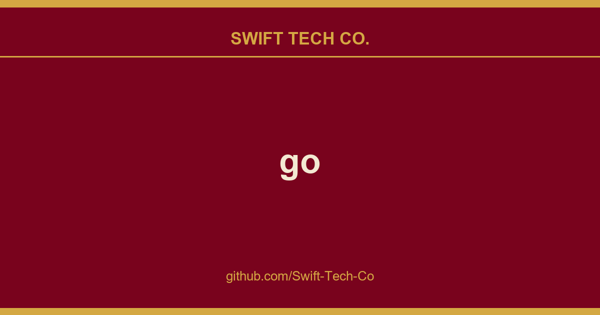

# go

## What This Is

A practical reference entry for product and engineering: the go notes, examples and fixes we reach for repeatedly. Kept current as part of the wider Swift Tech Co. engineering library.

## Images

[](https://github.com/Swift-Tech-Co/go)

## The Open Source Data Science Masters

The open-source curriculum for learning to be a Data Scientist. Curriculum resources from both universities and working Data Scientists focuses on foundational theory and applied skills. The OSDSM is collectively-maintained and open to PRs.

The goal of this curriculum is to prepare the student for an entry level Data Scientist role, using open source materials, at no cost but with the same calibur of materials found in the most reputable paid programs. Books not offered for free are often available through a public library, also indicated here with current list price. The Masters is self-guided and self-accredited. To better support credibility, the structure now includes a Capstone project intended to demonstrate the student's problem solving approach, skills in execution, and communication. Upon completion, the student can award oneself a Credential on LinkedIn from the Open Source Data Science Masters. As with all things, the OSDSM is best played as a team sport (try finding people on r/learndatascience).

This is called a "Masters" because it is primarily concerned with "upper-level" college course material in mathematics, programming, economics, or related disciplines. Come as you are!

1. **📖 The Core** - This is a critical foundation for what is to come; don't skip the foundational lessons.
2. **❄️ Specialty** - Choose what is most interesting to you, or most relevant to the work you plan to do.
3. **🤝 Doing Data Science** - Learn about how doing science with others and for businesses can work.
4. **🧑‍💻 Capstone Project** - Choose a meaningful project or dataset to demonstrate what you've learned.

## 📖 The Core
_This is a critical foundation for what is to come; don't skip!_

### What is Data Science?
One could argue that "Data Science" is a recent term for an already existing information analysis discipline. Humans instinctually search for patterns, a purpose we also see in this more digitized discipline. Read different sources (and search beyond this list) about the uses of data science.
- The Signal and The Noise / Nate Silver Book ```$18``` -- Narrated cases of Data Science at play in the real world.
- Dataclysm: Who We Are (When We Think No One's Looking) / Christian Rudder Book ```$17``` -- From the inside of OKCupid, real examples of how data science can illustrate human behavior.
- Informatics of the Oppressed / Rodrigo Ochigame Logic Magazine -- _Algorithms of oppression have been around for a long time. So have radical projects to dismantle them and build emancipatory alternatives._
 * A showcase of Jupyter Python Data Analysis Notebooks across disciplines.

### Foundations of Data Science

#### Problem Solving
 * Problem-Solving Heuristics "How To Solve It" George Pólya Berkeley / Summary Book ```$18```

### The Scientific Process & Experimentation
It is crucial as a Data Scientist that you show integrity in and transparency of scientific process. Even if you've been here before, review and draw out the process diagram for the scientific method.
- The Scientific Process
- Research Design A Step-by-Step Guide
- A Quick Guide to Experimental Design

#### Querying Data
Get familiar and comfortable with manipulating data in a database with a common relational querying language. There are diverse query languages, but SQL is a widely used foundation.
 * SQL School Mode Analytics / Tutorials

### Math & Statistics

#### Calculus
 * Single Variable Calculus MIT OpenCourseWare
 * Multivariable Calculus MIT OpenCourseWare

#### Linear Algebra
The foundational mathematics for working with large samples of data. Spend time in exercises until you feel highly confident in the key topics of Linear Algebra. It will serve you well.
 * An Intuitive Guide to Linear Algebra Better Explained / Article
 * A Programmer's Intuition for Matrix Multiplication Better Explained / Article
 * Vector Calculus: Understanding the Cross Product Better Explained / Article
 * Vector Calculus: Understanding the Dot Product Better Explained / Article
 * Linear Algebra Khan Academy / Videos
 * Linear Algebra MIT

#### Statistics
How can we answer questions with data? Everywhere you look, you'll see methods from statistics. Spend a lot of time here!
 * Stats in a Nutshell Book ```$46```
 * Think Stats: Probability and Statistics for Programmers Digital & Book ```$34```
 * Think Bayes Digital & Book ```$25```
 * Probabilistic Programming and Bayesian Methods for Hackers Github / Tutorials

### Working in Python

#### Learn Python
If you're starting from scratch with Python, start with this series.
 * Learn Python the Hard Way Digital & Book ```$37```

#### Environment & Libraries
Set up your computer to use tools locally.
 * Installing Basic Packages: Python, virtualenv, NumPy, SciPy, matplotlib and IPython 
 * For scientific uses: Using Python Scientifically & Command Line Install Script for Scientific Python Packages

#### Data Analysis
Get familiar with using tools to do data analysis. Pro tip: Write out what you're going to do before you do it! When you hit a snag, return to your plan and rechart as necessary.
* pandas tutorials
* Pandas Cookbook Examples
* Data Analysis in Python Tutorial
* Intro to Data Science / Course $0

#### Python Programming + Algorithms
How does a computer know what to do? Algorithms are instructions with a fancy name. Learn how instructions are encoded, how to think about structuring those instructions, and patterns for making it work in code.
 * Algorithms Design & Analysis I Stanford / Coursera
 * numpy Tutorial / Stanford CS231N

### Survey Courses
Courses with many of the topics above included. Be sure you fill in any gaps!
- Intro to Data Science / University of Washington Lectures
- (Short Survey) Doing Data Science: Straight Talk from the Frontline O'Reilly / Book ```$50```

## ❄️ Specialty: Choose 2
_Choose what is most interesting to you, or most relevant to the work you plan to do._

### Causation
A branch of statistics that uses graphical models and specialized statistics to describe and model cause and effect.

 * The Book of Why Book ```$17```
 * Causal Inference in Statistics Book ```$46```

### Natural Language Processing
The imperfect and immensely useful art (science?) of transforming human language into data.
 * From Languages to Information / Stanford CS147 Materials
 * NLP with Python (NLTK library) Digital, Book ```$55```
 * How to Write a Spelling Correcter / Norvig Tutorial

### Graph Analysis
Human relationships can be modeled as a network or graph. Many other things suit this model, too. Working with graphs 
 * Social and Economic Networks: Models and Analysis / Stanford / Coursera
 * Social Network Analysis for Startups Chapter 1 & Book ```$25``` ```networkx```

### Machine Learning
This is a huge space with infinite things to learn. For advanced statistical foundation, see The Elements of Statistical Learning.
 * Intro to scikit-learn, SciPy2013 youtube tutorials
 * Machine Learning for Hackers ipynb / digital book
 * Machine Learning Ng Stanford / Coursera & Stanford CS 229
 * Programming Collective Intelligence Book ```$46```

### Visualization
The most persuasive data stories are ones you can see with your own eyes. Make it visual!

#### Courses
 * Data Visualization University of Washington / Slides & Resources
 * Rice University's Data Viz class Rice University / Slides

#### Books
 * Envisioning Information Tufte / Book ```$36```
 * Interactive Data Visualization for the Web / Scott Murray Online Book & Book `$50`

### Linear Programming + Convex Optimization
If you have interest in operations management, manufacturing, supply chains, or other real world queuing problems, dig in here.
 * Linear Programming (Math 407) University of Washington / Course
* Convex Optimization / Boyd Stanford / Lectures / Book

### Deep Learning / Neural Networks
 * Neural Networks Andrej Karpathy / Python Walkthrough
 * Neural Networks for Machine Learning Geoffrey Hinton / U Toronto
 * Deep Learning for Natural Language Processing CS224d Stanford

## 🤝 Doing Data Science
_Learn about how doing science with others and for businesses can work._

### What is the job?

In ideal terms, a Data Scientist advises strategic decision-making using data-backed analysis and tested hypotheses. YMMV as this depends on the company needs and the team being supported.

* What Professional Data Scientists Actually Do Video
* The Data Science Handbook: Advice and Insights from 25 Amazing Data Scientists Book ```$25```

### Communication and Teamwork

For a Data Scientist's work to be impactful, they must be effective at communicating their work and findings. In any setting, clear logic and effective business writing are crucial to reaching your audience. And of course, doing Data Science with a team over zoom is different from being in person in an office. There is much more written communication and asynchronous consumption of content in the remote office environment. More than ever, writing and communication skills are crucial to being an effective Data Scientist for yourself and your team.

* LEADERSHIP LAB: The Craft of Writing Effectively UChicago / Video. Recommend watching this twice and taking notes.

#### The Data Scientist works in a Team
In the modern organization, it is very rare that a Data Scientist works in isolation. Communicating the value of the work being done is crucial to getting buy-in from partners whose decisions and operations depend on your work. Those partners might be:
- Product Managment
- Engineering
- Design (User Experience, Research, Product)
- Operations (Project Management, Customer Service Agents, Data Management)
- Marketing
- Finance Operations
- etc.

Typically, the more clearly you are able to communicate the "why", the **value of what you are doing**, the more these teams will be able to support you and your work in conversations you may not be a part of. Even if others don't understand "how" you do your work (which is very important to you and your manager!), they will be able to understand and repeat a well-communicated "why". This is why we write Specs, to get buy-in and allow for questions or input, before the work starts.

#### The Spec
A document conveying the motives, direction, investment, and expected value of the work.

* Goal / "Why" -- What is the point of this work? What decision is the organization trying to make?
* Impact -- What decisions might be made differently as a result of this work? What is the expected value?
* Data -- What evidence will this draw on?
* Assumptions -- What evidence does not exist? What assumptions are necessary or agreed upon?
* Methods / "How" -- Overview methods expected to be used. Analysis, with what tools? Experimentation, with what methodology?
* Results -- (to be filled in as completed)

#### Results Presentation
A slide deck or document with the goal of conveying the results of the work and how the findings support an important decision(s).

Best appended to the Spec, and summarized in a slide deck for easy consumption. Depending on the culture of the group, slides or a short document may be easier to look through to understand the results of the work. In the remote work era, think about how your work will be passed around and make sure your "above the fold" is easy to understand and clearly conveys the "why" and results in particular.

__Example__: A particularly polished presentation of map quality study results showing higher data quality in US maps on OSM than commercially available alternatives.  The impact of this work was a) increased confidence in service reliability for the company and b) enabled the company to decide against buying a commercially available annual license costing millions of dollars annually.

## 🧑‍💻 Capstone Project
_Choose a meaningful project or dataset to demonstrate what you've learned._

### Pick a dataset that you care about
* The very detailed data is plural
* Collection of datasets

### Formulate a Hypothesis & Write a Spec
Review the earlier reading on The Scientific Process. Formulate a clear, concise hypothesis. This is the headliner of your [Spec](#the-spec), flesh that out.

### Show your work + Explain why you chose this project
Show the process you used to disprove your hypothesis, preferably in a jupyter notebook. See examples to get a taste of how you can showcase your work.

### Graduate!
1. Create a document or github repo showcasing the list of courses and materials you completed. Include your project materials. Also recommended: include a personal statement about why you chose this course of study and what you seek to do with it.
2. Award yourself a Credential on LinkedIn from _The Open Source Data Science Masters_, with a link to the documentation you created.
3. Congratulations! 🎉

***
### So Extra "Extracurriculars"
* The Elements of Statistical Learning / Stanford Digital & Book ```$90``` & Study Group
* Python Data Science Handbook: Essential Tools for Working with Data Book ```$60```
 * The Manga Guide to Linear Algebra Book ```$19```
 * Mining The Social Web Book ```$46```
 * The Truthful Art: Data, Charts, and Maps for Communication Cairo / Book ```$50```
 * Exploratory Data Analysis Tukey / Book ```$81``` ```$113```
 * Mining Massive Data Sets / Stanford Course & Digital Textbook & Book ```$58```
 * Introduction to Information Retrieval / Stanford Digital & Book ```$70```
 * Probabilistic Graphical Models Stanford / Coursera
 * Differential Equations in Data Science Python Tutorial
 * Algorithm Design, Kleinberg & Tardos Book ```$125```
 * Tidy Data in Python
 * Designing, Visualizing and Understanding Deep Neural Networks Berkeley CS294-129
 * Python for Data Analysis Book ```$55```
 * Think Python Digital & Book ```$45```
 * The Visual Display of Quantitative Information Tufte / Book ```$27```
 * Information Dashboard Design: Displaying Data for At-a-Glance Monitoring Stephen Few / Book ```$29```
 * D3 Library / Scott Murray Blog / Tutorials
 * SQL Tutorials SQLZOO / Tutorials
 * Machine Learning Caltech / Edx
 * A Course in Machine Learning UMD / Digital Book
 * Designing Data Intensive Applications Book ```$56```

***

#### `Take Two` Change Log
1. Restructured ala the 2022 Plan.
2. Pruned broken links. It's been a while, and some of these resources have moved -- or worse -- been taken down.
3. Pared down links to a more opinionated list.

Please Contribute; **this is Open Source!**

_RIP v1.0 commit_

---

## Swift Tech Co.

Built and maintained by Swift Tech Co.

AI Automation | FinTech Platforms | Custom Software and Mobile Apps | SaaS Platforms | Cloud Infrastructure | Cybersecurity | SEO and Marketing | API Integration

**Join our community on Telegram:** [t.me/+Qt_eFvkb2rliMzNh](https://t.me/+Qt_eFvkb2rliMzNh)

Home | Services | Careers | Referral Program | Influencers | About | Contact

**Connect**

- Website: https://github.com/Swift-Tech-Co/go
- LinkedIn: [linkedin.com/in/stephenoladoke](https://www.linkedin.com/in/stephenoladoke/)
- LinkedIn (Company): [linkedin.com/company/swift-tech-co](https://www.linkedin.com/company/swift-tech-co)
- X: [@MrOladoke](https://x.com/MrOladoke)
- Instagram: [@mr.oladoke](https://www.instagram.com/mr.oladoke/)
- Instagram (Company): [@swifttechco](https://www.instagram.com/swifttechco/)
- Organization: [github.com/Swift-Tech-Co](https://github.com/Swift-Tech-Co)

## Sources

Compiled and maintained from upstream [golang/go](https://github.com/golang/go) under permissive open-source license.

---

Maintained by [Swift Tech Co.](https://github.com/Swift-Tech-Co) - [Telegram](https://t.me/+Qt_eFvkb2rliMzNh)

## Sources

Compiled and maintained from upstream [golang/go](https://github.com/golang/go) under permissive open-source license.

---

Maintained by [Swift Tech Co.](https://github.com/Swift-Tech-Co) - [Telegram](https://t.me/+Qt_eFvkb2rliMzNh)